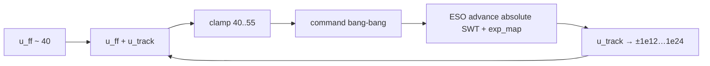
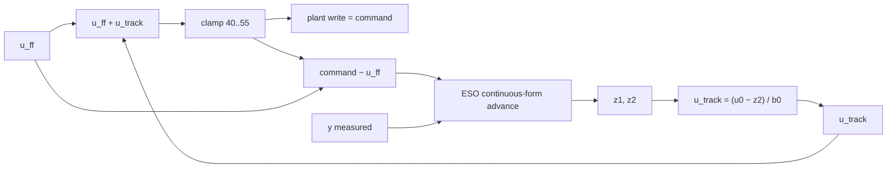

# Architecture diagrams — LADRC blow-up

## Saturation thrashing loop (observed failure)

When `u_track` diverges, `clamp(u_ff + u_track)` to `[setpoint_min, setpoint_max]` produces bang-bang commands. Under the broken path the ESO used absolute SWT (and/or saturated `exp_map` gains at `dt=60`), so divergence persisted.

## Target control / observer split

Plant write stays absolute SWT; ESO known input is the post-clamp tracking residue. ESO advance is continuous-form (`β1=2ωo`, `β2=ωo²`), not `exp_map`.

