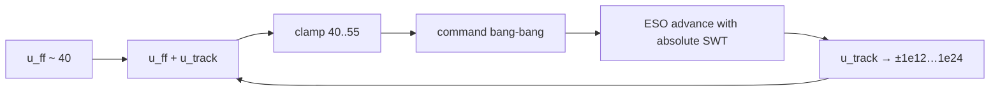

# Architecture diagrams — LADRC blow-up

## Saturation thrashing loop (observed failure)

When `u_track` diverges, `clamp(u_ff + u_track)` to `[setpoint_min, setpoint_max]` produces bang-bang commands; the ESO then advances on those absolute SWT values and the divergence persists.

