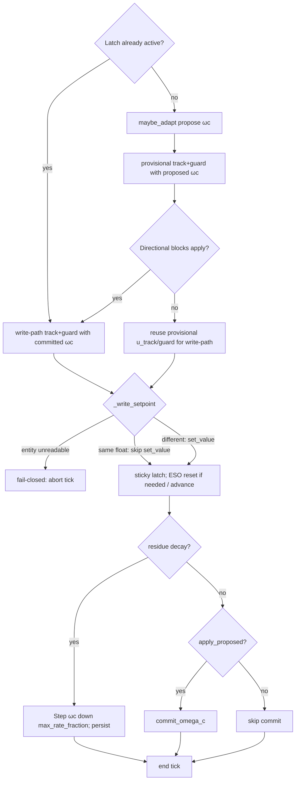

# Tick flow (gate ωc on saturation)

While latch is already active, adapt is skipped for the whole tick. Decay persist is a separate branch and is not blocked by the guard-trip skip of normal `commit_omega_c`. Post-write J is `apply_proposed` (not a second `should_apply_omega_c` call).
